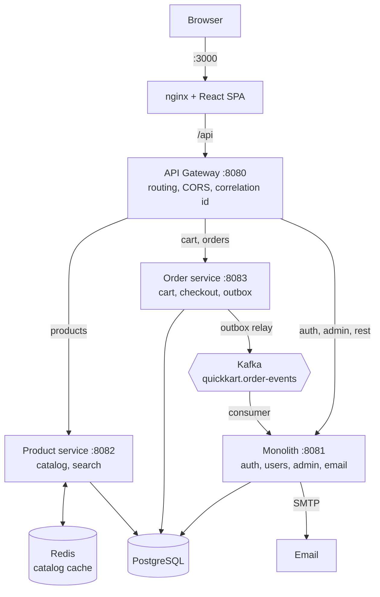

# QuickKart
[](https://github.com/JayantBansal900/QuickKart/actions/workflows/ci.yml)

A full-stack e-commerce app: a React storefront and admin panel on top of Spring Boot services behind an API gateway, with PostgreSQL, Redis and Kafka. It runs locally with Docker Compose.

**Stack:** Java 17 · Spring Boot 3.5 · Spring Cloud Gateway · Spring Security (JWT) · JPA/Hibernate · PostgreSQL 15 · Flyway · Redis 7 · Apache Kafka 3.7 (KRaft) · React 19 · TypeScript · Vite · Tailwind CSS 4 · Docker Compose · GitHub Actions

> **Ideas, not code:** features such as coupons, returns, dispatch tracking and abandoned carts were modelled on what open-source stores like Saleor, Medusa, Solidus and Magento offer, and designed from scratch for QuickKart (none of their code is used).
>
> **Separate sign-ins:** customers use the store sign-in; administrators use `/admin/login`. Each is refused on the other's page.
>
> **Scope note.** Payments are **cash on delivery** or **UPI / card through a simulated gateway** (test mode: no real money, no card data; the shopper picks success or failure). Because the shopper decides the outcome, the simulated gateway is **switched off in the `prod` profile**, where only cash on delivery is offered. The project is not deployed to the cloud; it runs on Docker Compose.

---

## What it does

**Customers**
- Sign up with email + password, then verify the account with a 6-digit code sent by email (real SMTP, e.g. Gmail).
- **Two-step sign-in** for customers and the admin: after the password, a 6-digit code is emailed (valid 5 minutes, 5 tries, one-time use); only the code gives a session.
- Forgot / reset password by emailed code. A reset signs the account out on every device.
- Browse **30 QuickKart own-brand products** in three categories (Clothing, Shoes, Accessories). Every product image is drawn by `scripts/catalog/design-products.mjs` in one house style with the QuickKart logo, so there are no third-party photos. Server-side search, category / size / colour / price filters, sort and pagination.
- **System Status with troubleshooting** (admin): PostgreSQL, Redis, Kafka, product-service, order-service and the order-event outbox each show UP/DOWN; clicking one shows its numbers (DB size and schema version, cache hit rate, Kafka consumer lag and failed events, waiting outbox events…), the problems found, what to do, and the fixes that are safe to run from the browser: **clear the product cache** and **replay failed (dead-letter) order events**.
- Clothes and shoes have **sizes and colours**, each with its own stock (S–XXL, waist 28–36, UK 6–11). The cart, checkout, cancellation and returns all work per size; sold-out sizes are shown struck through, and the Fashion category can be filtered by size and colour.
- Cart, then checkout with a saved delivery address: pay by cash on delivery, or by UPI / card through the simulated gateway (a failed payment can be retried; unpaid orders are cancelled after 30 minutes and their stock released).
- Order history with a step tracker (`Placed → Confirmed → Packed → Shipped → Out for delivery → Delivered`), cancellation with stock restore and an automatic refund for paid orders.
- Emails sent asynchronously through Kafka: order confirmation, payment received / failed, shipped, out for delivery, delivered, cancelled.
- Review products you received (verified purchase, one review each, editable); ratings update live.
- Coupons at checkout (offers list or typed code; percent or flat, minimum order, usage limits, once per customer).
- Wishlist (heart on every product, saved list in the account area).
- Dispatch tracking (courier and tracking number on the order and in the shipping email), a printable GST invoice, and returns within 7 days of delivery.
- Store information pages (about, contact, shipping, refunds, privacy, terms). Light / dark theme.

**Admins** (`/admin`)
- Overview: booked and collected revenue, orders awaiting fulfilment, low-stock alerts.
- Analytics: revenue and orders per day (7 / 30 / 90 days, chart or table), best sellers, revenue by category, orders by status, payment mix, new customers.
- Orders (paged, searchable): move an order through `PLACED → CONFIRMED → PROCESSING → SHIPPED → OUT_FOR_DELIVERY → DELIVERED`, or cancel it.
- Products (paged, searchable): create, edit, delete, upload a photo. Categories: add, rename (moves its products), hide, reorder, delete when empty.
- Inventory: restock or correct stock, and see each product's full stock history (orders, cancellations, restocks, edits, returns).
- Dispatch: marking an order shipped asks for the courier and tracking number.
- Returns: approve (restock and refund) or reject customer return requests.
- Coupons: create, edit, switch off and delete discount codes. Carts: see open and abandoned carts with their contents.
- Customers (paged, searchable): suspend or reactivate accounts. Admins can't change their own account or other admins.
- System: live UP/DOWN status of PostgreSQL, Redis, Kafka, both services and the order-event outbox.

---

## Architecture



All services share one PostgreSQL database, and each service owns its own tables and endpoints. More detail is in [docs/architecture.md](docs/architecture.md).

### Engineering highlights

| Problem | How QuickKart handles it |
|---|---|
| Overselling when two people buy the last item | Checkout locks the product rows (`SELECT … FOR UPDATE`) and the user row, and checks stock inside one transaction. |
| Double orders from a double-click or a retry | Each checkout carries an idempotency key and a cart fingerprint. A repeat returns the same order, and a reused key with different details is rejected (`409`). |
| Payment state | Online orders wait in `PENDING` until the (simulated) gateway confirms; success moves them to `PLACED`, a failure keeps them payable, a repeated success callback is idempotent, and a scheduled job cancels unpaid orders after 30 minutes under a row lock. Cancelling a paid order refunds it. |
| Losing order events if Kafka is down | **Transactional outbox.** The event row is written in the same transaction as the order, and a relay publishes it later (oldest first, retried until Kafka accepts). |
| Auditing stock | Every stock change (checkout, cancellation, restock, correction, edit) writes a `stock_movements` row in the same transaction. |
| Sending the same email twice | The consumer records each `eventId` in `processed_events` and skips duplicates (at-least-once delivery, idempotent handling). Failed messages are retried 3× and then go to a dead-letter topic. |
| Slow catalog queries | Search runs on the server (JPA Specifications + DB indexes). Results are cached in Redis for 60 s, evicted on writes, and fall back to the DB if Redis fails. |
| Stolen JWT still valid after a password reset | Each request re-checks the account in the DB, and tokens issued before `password_changed_at` are rejected. |
| OTP brute force / account enumeration | Codes are stored as purpose-bound HMACs. Login, verify, resend, forgot and reset are rate-limited per email and per IP. Unknown emails get the same responses and timing as real ones. |

---

## Measured performance

Measured on the local Docker stack (16 vCPU, 8 GB for Docker), 20 concurrent clients, 15 s per scenario, through the gateway. Command: `node scripts/load-test.mjs`.

| Scenario | req/s | p50 | p95 | p99 | Errors |
|---|---:|---:|---:|---:|---:|
| Catalog search, Redis cache hit | 914 | 20.0 ms | 39.0 ms | 57.0 ms | 0 |
| Catalog search, cache miss (hits PostgreSQL) | 611 | 30.3 ms | 57.2 ms | 77.1 ms | 0 |
| Category counts (cached) | 1112 | 16.1 ms | 29.7 ms | 52.5 ms | 0 |
| Gateway health (routing overhead baseline) | 1399 | 12.9 ms | 24.4 ms | 39.8 ms | 0 |

Measured on the 144-product catalog, median of four runs after a warm-up run. Caching gives about 1.5× the search throughput on this small catalog (2.7× when the catalog had 535 products), because the uncached query gets more expensive as the table grows. These are local numbers for comparison, not a production SLA. See [docs/performance.md](docs/performance.md).

---

## Run it locally

**Needs:** Docker Desktop, JDK 17+, Maven 3.9+ (Node 22+ only for frontend development).

```bash
cp .env.example .env
```

Then edit `.env`:

| Setting | Value |
|---|---|
| `JWT_SECRET`, `OTP_HASH_SECRET` | two different random keys, e.g. from `openssl rand -base64 48` (required: Compose refuses to start without them) |
| `REDIS_PASSWORD` | any random value, e.g. from `openssl rand -hex 24` (required) |
| `DEV_ADMIN_ENABLED`, `DEV_ADMIN_EMAIL`, `DEV_ADMIN_PASSWORD` | `true`, any email, a password of 12+ characters, if you want the admin panel |

Everything else has working defaults. The 30-product catalog is seeded automatically on first start (`DEV_PRODUCTS_ENABLED=true`). The store has one administrator, created from `DEV_ADMIN_*` in `.env`.

```bash
for s in monolith product-service order-service api-gateway; do (cd backend/services/$s && mvn -q package -DskipTests); done
```

```bash
docker compose up -d --build --wait
```

The first start builds the images (the React app is built inside Docker) and takes a few minutes; `--wait` returns when everything is healthy. A one-shot `db-migrate` container applies the Flyway migrations before the services start.

- Storefront: http://localhost:3000
- Admin panel: http://localhost:3000/admin/login (dev admin from `DEV_ADMIN_*` in `.env`)
- Gateway health: http://localhost:8080/actuator/health

With `MAIL_TRANSPORT=console` (the default), OTP emails are written to the monolith log instead of being sent (`docker logs quickkart-monolith`). To send real email, set `MAIL_TRANSPORT=smtp` and the `SMTP_*` values (Gmail needs an App Password). More detail is in [docs/development.md](docs/development.md).

## Tests

| Suite | Count | Command |
|---|---:|---|
| Monolith (auth, two-step sign-in, admin, analytics, system troubleshooting, email, Kafka consumer, security) | 109 | `mvn verify` in `backend/services/monolith` |
| Order service (cart, checkout, payments, coupons, returns, outbox) | 63 | `mvn verify` in `backend/services/order-service` |
| Product service (search, cache, admin, categories, reviews, wishlist, stock history) | 55 | `mvn verify` in `backend/services/product-service` |
| API gateway | 7 | `mvn verify` in `backend/services/api-gateway` |
| Frontend (Vitest + Testing Library) | 106 | `npm test` in `frontend` |
| End-to-end against the running stack | 104 checks | `node scripts/e2e-smoke.mjs .` (needs `MAIL_TRANSPORT=console`) |

Kafka tests use an embedded broker. PostgreSQL-specific tests (locking, migrations) run against a Testcontainers database in CI. GitHub Actions runs all of these on every push ([ci.yml](.github/workflows/ci.yml)).

## Repository layout

```
backend/services/
  api-gateway/       Spring Cloud Gateway: routes, CORS, client-IP + correlation-id filters
  monolith/          auth, OTP, password reset, users, admin APIs, email, Kafka consumer
  product-service/   catalog, search, Redis cache, admin product + stock APIs
  order-service/     cart, checkout, order lifecycle, transactional outbox relay
frontend/            React 19 + TypeScript storefront and admin panel
infrastructure/
  docker/            Dockerfiles and nginx config
  postgres/          init schema + Flyway migrations (V1…V11)
scripts/             e2e smoke test, load test, catalog photo pipeline, database maintenance SQL
docs/                architecture, API reference, development, performance, interview guide
```

## Documentation

- [Architecture and design decisions](docs/architecture.md)
- [API reference](docs/api.md)
- [Development guide](docs/development.md)
- [Performance](docs/performance.md)
- [Interview guide](docs/interview-guide.md)

## Limitations and next steps

- **Payments are simulated.** The gateway step has the same state machine a real one needs (pending, paid, failed, retried, refunded, expired), but no provider (Razorpay / Stripe test mode) is wired in.
- **Not deployed.** The `deploy-aws.yml` workflow is a placeholder; a cloud deployment needs an account and its costs approved.
- **One shared PostgreSQL** with clear table ownership, instead of a database per service.
- **JWT in `localStorage`**, protected by a strict Content-Security-Policy; an httpOnly cookie would be the next hardening step.
- **Observability** is health checks and logs; there are no metrics dashboards (Prometheus / Grafana) yet.
