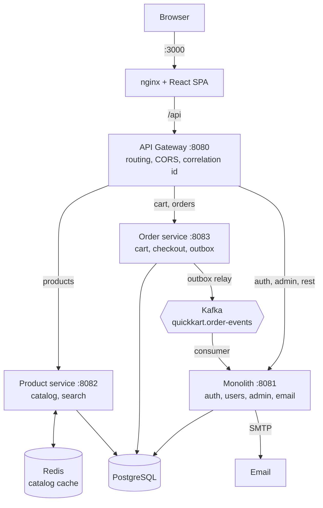

# QuickKart

A full-stack e-commerce app: a React storefront and admin panel on top of Spring Boot services behind an API gateway, with PostgreSQL, Redis and Kafka. It runs locally with Docker Compose.

**Stack:** Java 17 · Spring Boot 3.5 · Spring Cloud Gateway · Spring Security (JWT) · JPA/Hibernate · PostgreSQL 15 · Redis 7 · Apache Kafka 3.7 (KRaft) · React 19 · TypeScript · Vite · Tailwind CSS 4 · Docker Compose · GitHub Actions

> **Scope note.** Payment is **cash on delivery only**. There is no card/UPI gateway, and `POST /api/payments` deliberately returns `501`. The project is not deployed to the cloud; it runs on Docker Compose.

---

## What it does

**Customers**
- Sign up with email + password, then verify the account with a 6-digit code sent by email (real SMTP, e.g. Gmail).
- Forgot / reset password by emailed code. A reset signs the account out on every device.
- Browse 144 hand-picked products (18 per category, each with a photo) with server-side search, category filter, price range, sort and pagination.
- Cart, then COD checkout with delivery details, order history with a status tracker, and cancellation (stock is restored).
- Get an order-confirmation email, sent asynchronously through Kafka.
- Light / dark theme.

**Admins** (`/admin`)
- Overview: revenue collected, orders by status, low-stock alerts.
- Orders: move an order through `PENDING → CONFIRMED → PROCESSING → SHIPPED → DELIVERED` (or cancel it).
- Products: create, edit and delete products, and adjust stock.
- Users: suspend or reactivate customer accounts. Admins can't change their own account or other admins.
- System: live UP/DOWN status of PostgreSQL, Redis, Kafka, both services and the order-event outbox.

---

## Architecture



All services share one PostgreSQL database, and each service owns its own tables and endpoints. More detail is in [docs/architecture.md](docs/architecture.md).

### Engineering highlights

| Problem | How QuickKart handles it |
|---|---|
| Overselling when two people buy the last item | Checkout locks the product rows (`SELECT … FOR UPDATE`) and the user row, and checks stock inside one transaction. |
| Double orders from a double-click or a retry | Each checkout carries an idempotency key and a cart fingerprint. A repeat returns the same order, and a reused key with different details is rejected (`409`). |
| Losing order events if Kafka is down | **Transactional outbox.** The event row is written in the same transaction as the order, and a relay publishes it later (oldest first, retried until Kafka accepts). |
| Sending the same email twice | The consumer records each `eventId` in `processed_events` and skips duplicates (at-least-once delivery, idempotent handling). Failed messages are retried 3× and then go to a dead-letter topic. |
| Slow catalog queries | Search runs on the server (JPA Specifications + DB indexes). Results are cached in Redis for 60 s, evicted on writes, and fall back to the DB if Redis fails. |
| Stolen JWT still valid after a password reset | Each request re-checks the account in the DB, and tokens issued before `password_changed_at` are rejected. |
| OTP brute force / account enumeration | Codes are stored as purpose-bound HMACs. Login, verify, resend, forgot and reset are rate-limited per email and per IP. Unknown emails get the same responses and timing as real ones. |

---

## Measured performance

Measured on the local Docker stack (16 vCPU, 8 GB for Docker), 20 concurrent clients, 15 s per scenario, through the gateway. Command: `node scripts/load-test.mjs`.

| Scenario | req/s | p50 | p95 | p99 | Errors |
|---|---:|---:|---:|---:|---:|
| Catalog search, Redis cache hit | 867 | 21.9 ms | 35.6 ms | 45.6 ms | 0 |
| Catalog search, cache miss (hits PostgreSQL) | 317 | 58.6 ms | 94.3 ms | 196.1 ms | 0 |
| Category counts (cached) | 1037 | 18.1 ms | 29.8 ms | 43.7 ms | 0 |
| Gateway health (routing overhead baseline) | 1742 | 10.7 ms | 17.1 ms | 32.4 ms | 0 |

Values are the median of three runs. Caching gives about 2.7× the search throughput and less than half the p95 latency. These are local numbers for comparison, not a production SLA. See [docs/performance.md](docs/performance.md).

---

## Run it locally

**Needs:** Docker Desktop, JDK 17+, Maven 3.9+, Node 20+.

```bash
cp .env.example .env
```

Then edit `.env`:

| Setting | Value |
|---|---|
| `JWT_SECRET`, `OTP_HASH_SECRET` | two different random keys, e.g. from `openssl rand -base64 48` (required: Compose refuses to start without them) |
| `DEV_ADMIN_ENABLED`, `DEV_ADMIN_EMAIL`, `DEV_ADMIN_PASSWORD` | `true`, any email, a password of 12+ characters, if you want the admin panel |

Everything else has working defaults. The 144-product catalog is seeded automatically on first start.

```bash
for s in monolith product-service order-service api-gateway; do (cd backend/services/$s && mvn -q package -DskipTests); done
```

```bash
cd frontend && npm ci && npm run build && cd ..
```

```bash
docker compose up -d --build --wait
```

The first start builds the images and takes a few minutes; `--wait` returns when all eight containers are healthy.

- Storefront: http://localhost:3000
- Admin panel: http://localhost:3000/admin/login (dev admin from `DEV_ADMIN_*` in `.env`)
- Gateway health: http://localhost:8080/actuator/health

With `MAIL_TRANSPORT=console` (the default), OTP emails are written to the monolith log instead of being sent (`docker logs quickkart-monolith`). To send real email, set `MAIL_TRANSPORT=smtp` and the `SMTP_*` values (Gmail needs an App Password). More detail is in [docs/development.md](docs/development.md).

## Tests

| Suite | Count | Command |
|---|---:|---|
| Monolith (auth, admin, email, Kafka consumer, security) | 90 | `mvn verify` in `backend/services/monolith` |
| Order service (cart, checkout, outbox) | 42 | `mvn verify` in `backend/services/order-service` |
| Product service (search, cache, admin) | 40 | `mvn verify` in `backend/services/product-service` |
| API gateway | 7 | `mvn verify` in `backend/services/api-gateway` |
| Frontend (Vitest + Testing Library) | 73 | `npm test` in `frontend` |
| End-to-end against the running stack | 49 checks | `node scripts/e2e-smoke.mjs .` (needs `MAIL_TRANSPORT=console`) |

Kafka tests use an embedded broker. PostgreSQL-specific tests (locking, migrations) run against a Testcontainers database in CI. GitHub Actions runs all of these on every push ([ci.yml](.github/workflows/ci.yml)).

## Repository layout

```
backend/services/
  api-gateway/       Spring Cloud Gateway: routes, CORS, client-IP + correlation-id filters
  monolith/          auth, OTP, password reset, users, admin APIs, email, Kafka consumer
  product-service/   catalog, search, Redis cache, admin product + stock APIs
  order-service/     cart, checkout, order lifecycle, transactional outbox relay
frontend/            React 19 + TypeScript storefront and admin panel
infrastructure/
  docker/            Dockerfiles and nginx config
  postgres/          init schema + numbered SQL migrations
scripts/             e2e smoke test, load test, test-data cleanup SQL
docs/                architecture, API reference, development, performance, interview guide
```

## Documentation

- [Architecture and design decisions](docs/architecture.md)
- [API reference](docs/api.md)
- [Development guide](docs/development.md)
- [Performance](docs/performance.md)
- [Interview guide](docs/interview-guide.md)

## Not built (yet)

- Online payments (Razorpay or Stripe test mode). Today, checkout is COD only.
- Cloud deployment. The `deploy-aws.yml` workflow is a placeholder with no target.
- Separate databases per service. Today, one shared PostgreSQL with clear table ownership.
