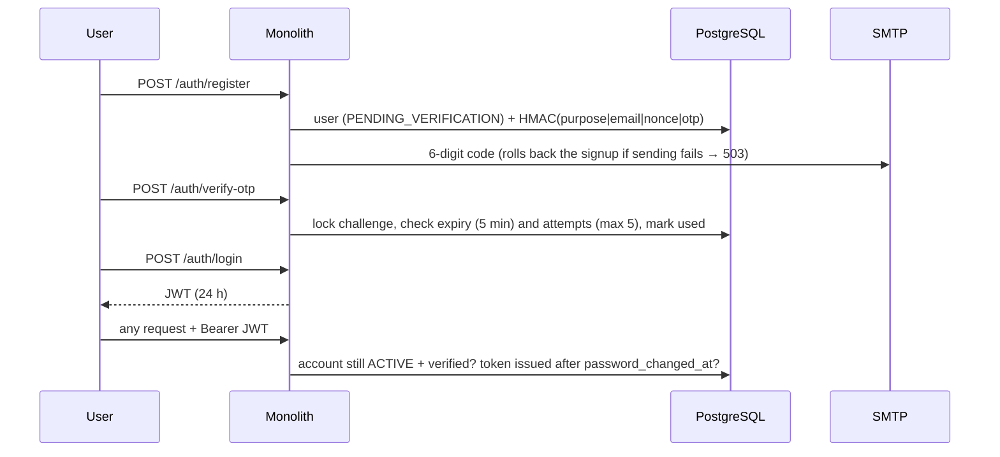
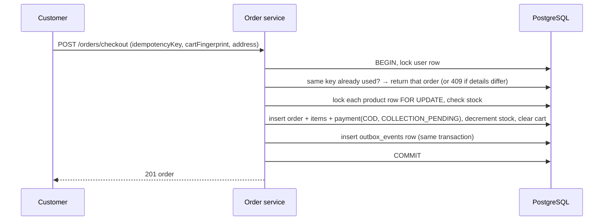
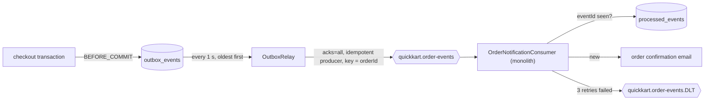

# Architecture and design decisions

## Components

| Component | Port | Owns |
|---|---|---|
| nginx + React SPA | 3000 | Serves the built frontend. Proxies `/api` to the gateway. `index.html` is `no-cache` and hashed `/assets/*` are `immutable`. |
| API gateway (Spring Cloud Gateway) | 8080 | The single entry point: path routing, CORS, `X-Correlation-ID`, and `X-Client-IP` for rate limiting. |
| Monolith | 8081 | Registration, OTP, login, password reset, profiles, admin users/analytics/system status, email, and the Kafka consumer. |
| Product service | 8082 | Catalog read/search, category counts, admin product CRUD and stock adjustment, and the Redis cache. |
| Order service | 8083 | Cart, COD checkout, order lifecycle (customer cancel, admin transitions), and the transactional outbox and relay. |
| PostgreSQL 15 | 5432 | One shared database. Schema in `infrastructure/postgres/init` plus numbered migrations. |
| Redis 7 | 6379 | Catalog cache and auth rate-limit counters. |
| Kafka 3.7 (KRaft) | 9092 | Topic `quickkart.order-events` and its dead-letter topic `quickkart.order-events.DLT`. |

### Gateway routing

Routes are matched top to bottom ([application.yml](../backend/services/api-gateway/src/main/resources/application.yml)):

| Path | Service |
|---|---|
| `/api/products/**`, `/api/admin/products/**` | product service |
| `/api/cart/**`, `/api/orders/**`, `/api/admin/orders/**` | order service |
| `/api/auth/**`, `/api/payments/**`, `/api/admin/**`, any other `/api/**` | monolith |

Cart, order and catalog code used to live in the monolith too. After the split, those copies were deleted, so each endpoint has exactly one implementation.

### Why a shared database?

The services were split out of a monolith step by step. Keeping one database avoided distributed transactions while the boundaries settled: each service owns its tables and endpoints, and the only cross-service writes are explicit (for example, checkout decrements `products.stock_quantity` under a row lock). The next step towards fully separate databases would be to replace that shared stock write with a reservation API or event. The outbox is already in place to make that safe.

---

## Authentication and account security

- **Passwords** are hashed with BCrypt. Unknown emails still run a dummy BCrypt check, so login timing does not reveal which emails exist.
- **OTP codes** are never stored in plain text. They are stored as HMAC-SHA256 over `purpose | email | nonce | otp`. Because the purpose is part of the hash, a sign-up code can't be used as a password-reset code. Verification uses a row lock, so a code can be consumed once even under concurrent requests.
- **Account enumeration.** Register, resend, forgot-password and verify give generic answers. The forgot-password email is sent after the transaction commits, on a background executor, so response time is the same whether the account exists or not.
- **Rate limits** (Redis counters with an in-memory fallback), per email and per IP:
  - login, verify and reset: 10 per 5 min
  - resend and forgot: 3 per 5 min
  - register: 5 per hour
  - IP-wide: 60 per minute
- **Client IP.** The gateway sets `X-Client-IP` from the real peer address. Services trust that header only when the request comes from a private or loopback address, so a client can't spoof its IP.
- **JWT revocation without a blacklist.** Each service's JWT filter checks the account in the database on every request: it must exist, be `ACTIVE` and verified, and keep the same role. A password reset sets `users.password_changed_at`, and any token whose `iat` is earlier is rejected (`401`) by the monolith *and* the order and product services.
- **Abandoned signups.** If someone registers but never verifies, registering again with the same email reuses that account, saves the new details and emails a fresh code (all older codes are voided). Verified accounts and admin accounts are never touched this way.
- **Roles.** `USER` and `ADMIN`. `/api/admin/**` requires `ADMIN` in every service. An admin can't suspend themselves or another admin (`409`).
- **Email.** `MAIL_TRANSPORT=console` logs emails in dev; `smtp` sends multipart HTML and text emails. The `prod` profile forces SMTP. Reserved test domains (`.invalid`, `.test`, `example.com`, …) are never emailed.

---

## Catalog search and caching

`GET /api/products` builds a JPA `Specification` from `q` (name, brand, description, category), `category`, `minPrice`, `maxPrice`, `sort` and paging, and returns a `PageResponse`.

- **Indexes.** Migration `003` adds indexes for the common filters and sorts.
- **Sorting.** "Rating" and "discount" sorts put NULL values last using `COALESCE` inside the specification, because Hibernate's Criteria API doesn't support `NULLS LAST`.
- **Cache.** Spring Cache on Redis:
  - Per-cache TTL is 60 s, and cache keys are built from the normalised search criteria.
  - Writes evict entries only after the transaction commits (`transactionAware`), so readers never cache data that was rolled back.
  - Deserialization uses a restricted polymorphic type validator, which allows only QuickKart DTO and JDK types.
  - A `CacheErrorHandler` logs Redis failures and lets the request fall through to PostgreSQL, so a Redis outage only slows the catalog down rather than breaking it.
- **Staleness.** The design is bounded staleness: after an admin edit, listings may be up to 60 s old. Checkout always reads live stock under a lock, so a stale page can never cause an oversell.

---

## Checkout

- **Cart fingerprint.** A hash of the cart's contents and prices that the customer confirmed. If the cart changed in another tab, checkout fails instead of charging for something the customer didn't see.
- **Idempotency key.** Generated per checkout attempt in the browser. A retry after a timeout returns the original order.
- **Order lifecycle.** `PENDING → CONFIRMED → PROCESSING → SHIPPED → DELIVERED`. An order can be cancelled before it ships, and cancellation puts the stock back. Marking an order `DELIVERED` sets the COD payment to `COLLECTED`; revenue analytics count only collected payments.

---

## Order events: outbox → Kafka → email

Why not publish to Kafka directly after commit? If the process dies or Kafka is down between the commit and the send, the event is lost. With the outbox:

- The event row commits or rolls back **with** the order, so there are no ghost events and no missing events.
- The relay publishes rows oldest-first and stops at the first failure, which preserves per-order ordering. The failed row stays pending, with `attempts` and `last_error` recorded, and is retried on the next tick.
- Delivery is **at least once**. After sending the email, the consumer stores the event's `eventId` in `processed_events` (primary key), and a redelivered event that is already recorded is skipped. Narrow edge case: if the process crashes after the email is sent but before the row is saved, the email can be sent twice. That is the usual trade-off when the side effect (SMTP) can't join a database transaction.
- A message that still fails after 3 retries, 2 s apart, goes to the dead-letter topic instead of blocking the partition.
- The admin **System** page shows how many outbox rows are pending, and reports DOWN if any row has waited more than 2 minutes.

---

## Observability

- Every service has a `/actuator/health` endpoint, and Docker Compose health checks gate container start-up order.
- `X-Correlation-ID` is created at the gateway (or accepted from the client), passed downstream, and put in the SLF4J MDC, so one request can be followed through all service logs.
- `GET /api/admin/system/status` probes each dependency with a 2 s timeout. It returns only UP/DOWN, latency, and a fixed description, never hostnames or exception text.
- Errors return a JSON body with a safe message. `500` responses never include exception details; those go to the log.
