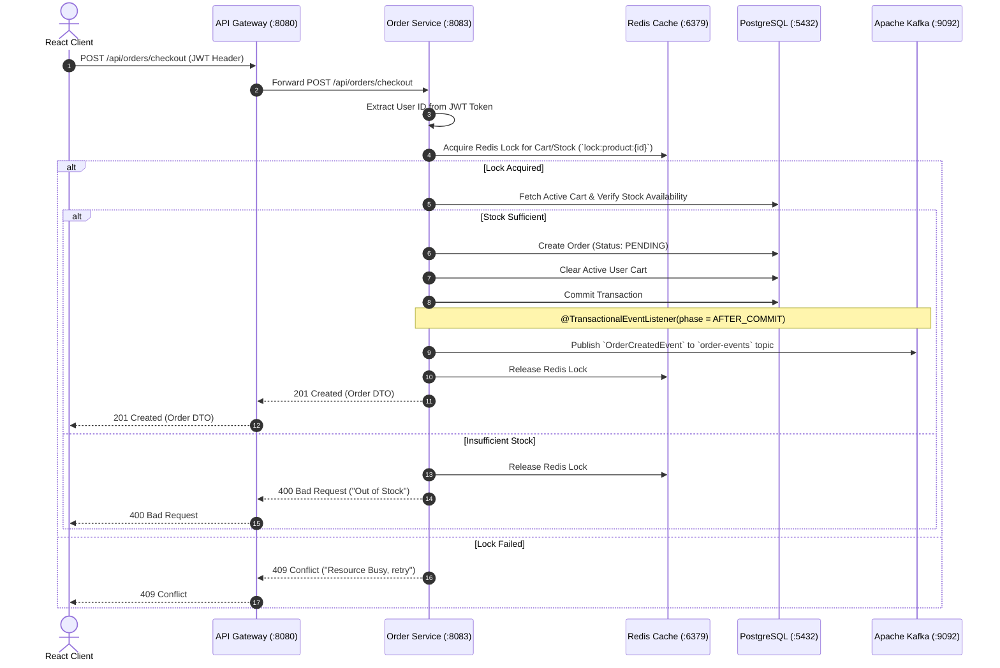
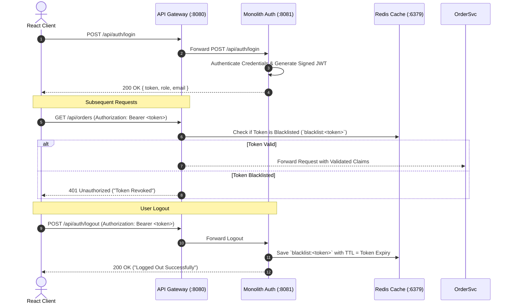

# QuickKart System Sequence Flows

This document details the critical runtime flows in QuickKart, including checkout execution, transactional event publishing with Kafka, distributed inventory locking, and token revocation.

## 1. Checkout & Order Placement Flow

## 2. Kafka Event Publishing (AFTER_COMMIT Guarantee)

To guarantee database consistency and prevent publishing events for rolled-back transactions, QuickKart uses Spring's `TransactionSynchronizationManager` and `@TransactionalEventListener(phase = TransactionPhase.AFTER_COMMIT)`.

1. **Transaction Begins**: `OrderService.createOrder()` begins a database transaction.
2. **Order Saved**: Order record is written to PostgreSQL in `PENDING` state.
3. **Event Registered**: `OrderCreatedEvent` is published internally via Spring `ApplicationEventPublisher`.
4. **Transaction Commit**: Spring commits the database transaction.
5. **After Commit Event Fired**: The event listener receives the event ONLY after successful DB commit and sends the payload to Kafka topic `order-events`.
6. **Failure Handling**: If the database transaction fails or rolls back, the Kafka event is **never sent**, eliminating ghost event processing downstream.

## 3. Distributed Inventory Locking with Redis

To avoid race conditions during flash sales:
1. When placing an order, `OrderService` attempts to acquire a short-lived key in Redis (`SET product:lock:{id} {owner} NX PX 3000`).
2. If successful, inventory validation and reservation proceed atomically.
3. If another request holds the lock, the thread waits or returns `409 Conflict`.
4. Once completed, a Lua script verifies ownership before releasing the lock to ensure safety under GC pauses or network delays.

## 4. Authentication & JWT Revocation Flow

